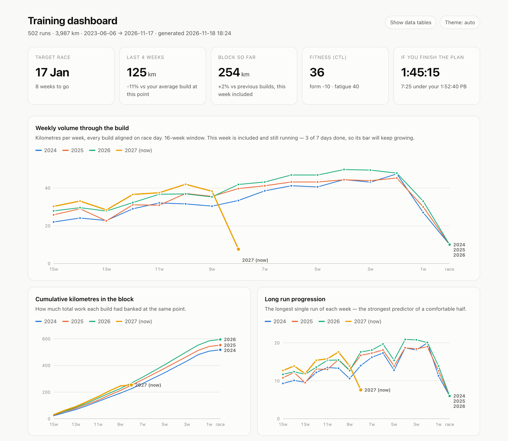

# strava-analytics

A local replacement for Strava's paid analysis, built around one question:
**how did I train into each half marathon, and where am I right now?**

Everything runs on your machine. Your data never leaves it.



*The dashboard, shown here with made-up sample data.*

## Why the bulk export, not the API

Since **30 June 2026** Strava's API — and the official MCP connector — require a
paid Strava subscription. The **bulk export is still free for every account** and
is actually the better source here: it contains your complete history plus the raw
`.fit`/`.gpx` recordings, with no rate limits. From those recordings this tool
computes your own best efforts, so the personal-best charts work without any API.

The API client is still in the repo (`./run auth`, `./run sync`) and works
unchanged if you ever subscribe.

## Setup

You need Python 3.

```bash
python3 -m venv .venv && ./.venv/bin/pip install -r requirements.txt
```

## Getting your data

1. Strava → **Settings → My Account → Download or Delete Your Account → Request your archive**.
2. Wait for the email (minutes to a few hours) and download the `.zip`.
3. Check that the columns are recognised before importing anything:

```bash
./run import ~/Downloads/export_12345678.zip --dry-run
```

4. Import for real:

```bash
./run import ~/Downloads/export_12345678.zip
```

This extracts the archive to `data/export/`, loads every run into
`data/strava.db`, parses each activity file for per-second heart rate, pace and
elevation, and computes best efforts at 1k / 5k / 10k / 15k / half marathon.
Parsing a few hundred files takes a couple of minutes. Re-running is safe: rows
are upserted by activity id and already-parsed files are skipped.

Useful flags: `--no-files` (skip recordings, much faster), `--all-sports`
(keep rides and swims too), `--limit-files N`.

To update later, request a fresh archive and import it again.

## Building the dashboard

```bash
./run dashboard
```

Writes `dashboard.html` — a single self-contained file, no server, no internet.
Open it any time; re-run after each import.

## Telling it about your races

Race detection is automatic: the fastest 20–23 km activity of each year, or
anything whose name looks like a race. To check and pin them:

```bash
./run races
```

It prints a JSON block to paste into `profile.json` under `"races"`. Pinning is
worth it — the build-up windows are measured backwards from these dates. Add your
upcoming race there too, with `"planned": true`, so "weeks to go" is exact instead
of projected from previous years.

`profile.json` also takes `max_hr`, `threshold_hr`, `threshold_pace_s_per_km` and
`build_weeks`. Anything left `null` is estimated from your data and the estimate
is stated at the bottom of the dashboard.

`profile.example.json` shows the format with made-up values. Your own
`profile.json` is git-ignored, like `data/` and the dashboard files.

## What the dashboard shows

- **Where you stand now** — weeks to race, last 4 weeks' volume and total block
  volume against your previous builds *at the same point*, current fitness, and a
  Riegel projection of your half time.
- **Weekly volume through the build** — every build aligned on race day.
- **Cumulative kilometres** — how much work each build had banked by this point.
- **Long run progression** — the weekly long run, build by build.
- **Intensity mix** — easy / moderate / hard share per build.
- **Fitness and fatigue** — CTL (42-day) and ATL (7-day) load averages, plus form (TSB).
- **Aerobic efficiency** — metres per minute per heartbeat on easy runs; the
  cleanest signal that aerobic fitness is actually improving.
- **Personal bests** — a panel per distance, stepping down over time.
- Data tables behind a toggle, dark mode, and everything hoverable.

## Layout

```
cli.py                     ./run <command>
strava_analytics/
  config.py                paths, .env, profile.json
  importer.py              bulk export -> SQLite (localised CSV parsing)
  exportfiles.py           .fit/.gpx/.tcx -> streams, metrics, best efforts
  auth.py, client.py       Strava OAuth + rate-limited API (needs a subscription)
  sync.py                  incremental API sync
  plan.py                  training plan import from an .ics calendar
  db.py                    SQLite schema
  analysis.py              build windows, intensity, load, predictions
  dashboard.py             self-contained HTML renderer
data/strava.db             your data
dashboard.html             the output
```

## Caveats worth knowing

- Training load uses average heart rate per run against threshold. That
  under-rates interval sessions, where average HR hides the peaks. Directionally
  sound; not a lab measurement.
- The Riegel projection assumes half-marathon-specific endurance you may not have
  if it is extrapolating from a 5k. Treat it as a ceiling.
- The in-progress week is excluded from weekly charts and comparisons — a
  half-finished week would read as a collapse in volume.

## License

MIT. See [LICENSE](LICENSE).
